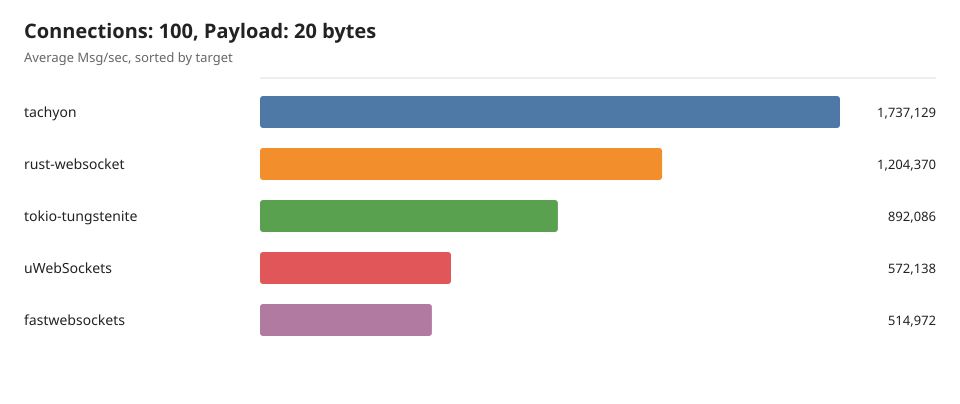
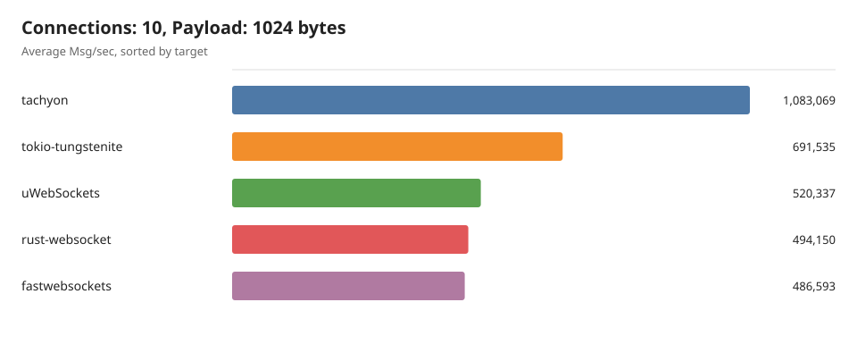
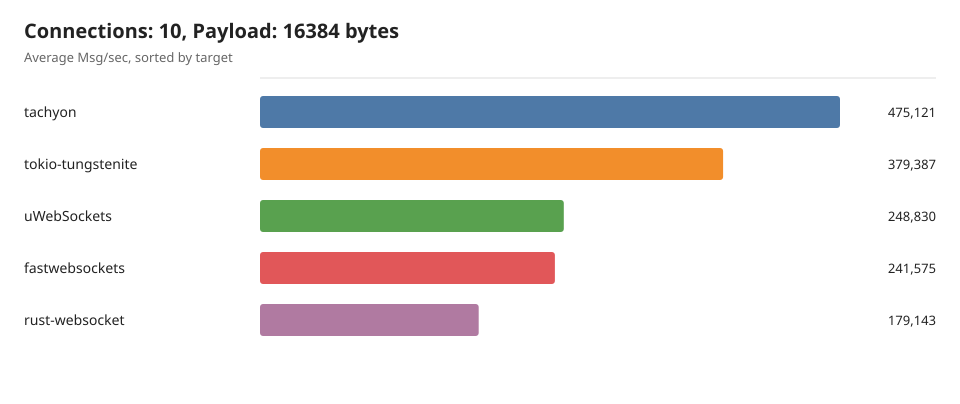
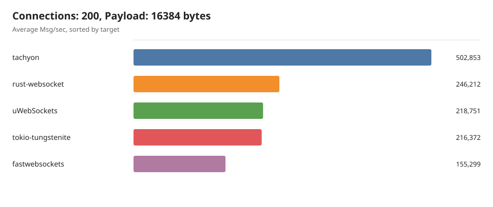
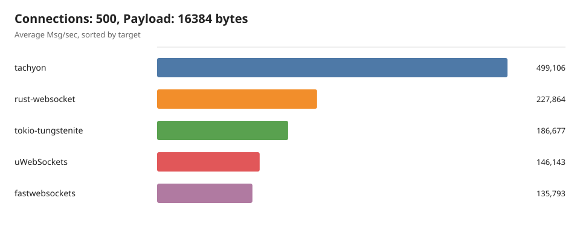

# tachyon benchmarks

The benchmark tools measure the tachyon data path and compare echo throughput
with several other WebSocket servers.

## Build

```sh
zig build examples benches -Doptimize=ReleaseFast
```

This installs:

- `zig-out/bin/tachyon-echo-server`
- `zig-out/bin/tachyon-load-test`
- `zig-out/bin/tachyon-unmask`

`zig build` remains library-only; the examples and benchmark steps are opt-in.
These steps require a full repository checkout because the published package
excludes `examples/` and `benches/`.

## Load generator

```sh
./zig-out/bin/tachyon-load-test <host> <port> <connections> <duration_seconds> <payload_bytes>
```

Each connection performs the tachyon client handshake, sends one binary message,
reads the echo, and repeats. The tool prints `Msg/sec <n>` once per second and a
final `Final Msg/sec <n>` line. Buffers are caller-owned per worker, and mask
keys use a deterministic seed for reproducibility.

Example against the bundled echo server:

```sh
./zig-out/bin/tachyon-echo-server &
./zig-out/bin/tachyon-load-test 127.0.0.1 8080 10 2 1024
```

## Unmask benchmark

```sh
./zig-out/bin/tachyon-unmask
```

Allocates a 64 MiB payload and repeatedly runs `tachyon.unmask`, then prints
`bytes/sec` and `GB/s`. The codec performs no allocation; the benchmark allocates
only its own buffer.

## Comparison runner

```sh
node benches/run.mjs
```

The runner executes the original comparison cases:

| Connections | Payload |
| ---: | ---: |
| 100 | 20 B |
| 10 | 1 KiB |
| 10 | 16 KiB |
| 200 | 16 KiB |
| 500 | 16 KiB |

For each case and target it starts the server, waits for the port, runs the load
generator for `BENCH_DURATION` seconds (default 5), averages the per-second
samples, stops the server, and updates the generated results block in this
README. It also writes one plain-SVG chart per case
(`<connections>-<payload_bytes>-chart.svg`) and links the charts in the generated
block. A startup grace period (default 1000 ms) follows port readiness; set
`BENCH_START_DELAY_MS` to adjust it. The same Markdown table is printed to stdout.
Missing targets are skipped rather than failing the run. Node is only the
runner; there is no JavaScript WebSocket target.

### Targets and overrides

| Target | Default command | Port | Environment override |
| --- | --- | ---: | --- |
| tachyon | `zig-out/bin/tachyon-echo-server` | 8080 | `TACHYON_ECHO_SERVER` |
| uWebSockets (C++) | `benches/.servers/uWebSockets/EchoServer` | 9001 | `UWEBSOCKETS_SERVER` |
| fastwebsockets | `benches/.servers/fastwebsockets/echo_server` | 8080 | `FASTWEBSOCKETS_SERVER` |
| tokio-tungstenite | `benches/.servers/tokio-tungstenite/echo-server` | 8080 | `TOKIO_TUNGSTENITE_SERVER` |
| rust-websocket | `benches/.servers/rust-websocket/async-autobahn-server` | 9002 | `RUST_WEBSOCKET_SERVER` |

The ports are fixed to match the competitor examples. `TACHYON_LOAD_TEST`
overrides the load generator path.

## Competitor setup

```sh
sh benches/setup-competitors.sh
```

The script fetches and builds the comparison servers into
`benches/.servers/`. Checkout sources go to `BENCH_CACHE_DIR` (default
`/tmp/tachyon-bench-cache`), so they are not bundled or vendored in the
repository. Both directories are ignored by Git.

Targets:

- uWebSockets: clones `uNetworking/uWebSockets` recursively and builds
  uSockets plus the examples through the project Makefile (`make default` and
  `make examples`), then copies the resulting `EchoServer`. If the Makefile's
  example runner cannot produce `EchoServer` on the current platform, the
  script reports the fallback and uses a direct compile. `MAKE`, `CXX`,
  `ZLIB_CFLAGS`, and `ZLIB_LIBS` override tools or zlib paths.
- fastwebsockets: builds the `echo_server` example with the `upgrade` feature.
- tokio-tungstenite: builds the `echo-server` example with the `handshake`
  feature.
- rust-websocket: builds `async-autobahn-server` with the `async` feature.
  Its default features use SSL; set `OPENSSL_INCLUDE_DIR` and `OPENSSL_LIB_DIR`
  (or `OPENSSL_DIR`) when the OpenSSL installation is not auto-detected.

`SKIP_UWEBSOCKETS`, `SKIP_FASTWEBSOCKETS`, `SKIP_TOKIO_TUNGSTENITE`, and
`SKIP_RUST_WEBSOCKET` skip individual targets. Missing tools or failed builds
are reported and the remaining targets continue; the script exits nonzero only
when every competitor fails.

## CI

`.github/workflows/bench.yml` is manual (`workflow_dispatch`) and runs weekly on
a schedule. It sets up Node 24 and stable Rust, builds the tachyon tools, runs
`sh benches/setup-competitors.sh` with `continue-on-error`, runs
`node benches/run.mjs`, appends the generated results block to the job summary,
and uploads `benches/README.md`.

The comparison builds are best-effort. Results are useful for relative
throughput checks, not as a compliance claim, and they depend on the runner,
kernel, connection setup, payload mix, and the other servers' versions.

## Generated results

The benchmark runner replaces only the text between these markers. Do not edit
inside the block by hand.

<!-- bench-results:start -->
Generated: 2026-11-28T11:38:02.043Z
Duration: 1s per case

| Target | Connections | Payload | Avg Msg/sec |
| --- | ---: | ---: | ---: |
| tachyon | 100 | 20 B | 1737129 |
| uWebSockets | 100 | 20 B | 572138 |
| fastwebsockets | 100 | 20 B | 514972 |
| tokio-tungstenite | 100 | 20 B | 892086 |
| rust-websocket | 100 | 20 B | 1204370 |
| tachyon | 10 | 1024 B | 1083069 |
| uWebSockets | 10 | 1024 B | 520337 |
| fastwebsockets | 10 | 1024 B | 486593 |
| tokio-tungstenite | 10 | 1024 B | 691535 |
| rust-websocket | 10 | 1024 B | 494150 |
| tachyon | 10 | 16384 B | 475121 |
| uWebSockets | 10 | 16384 B | 248830 |
| fastwebsockets | 10 | 16384 B | 241575 |
| tokio-tungstenite | 10 | 16384 B | 379387 |
| rust-websocket | 10 | 16384 B | 179143 |
| tachyon | 200 | 16384 B | 502853 |
| uWebSockets | 200 | 16384 B | 218751 |
| fastwebsockets | 200 | 16384 B | 155299 |
| tokio-tungstenite | 200 | 16384 B | 216372 |
| rust-websocket | 200 | 16384 B | 246212 |
| tachyon | 500 | 16384 B | 499106 |
| uWebSockets | 500 | 16384 B | 146143 |
| fastwebsockets | 500 | 16384 B | 135793 |
| tokio-tungstenite | 500 | 16384 B | 186677 |
| rust-websocket | 500 | 16384 B | 227864 |

### Charts










<!-- bench-results:end -->
